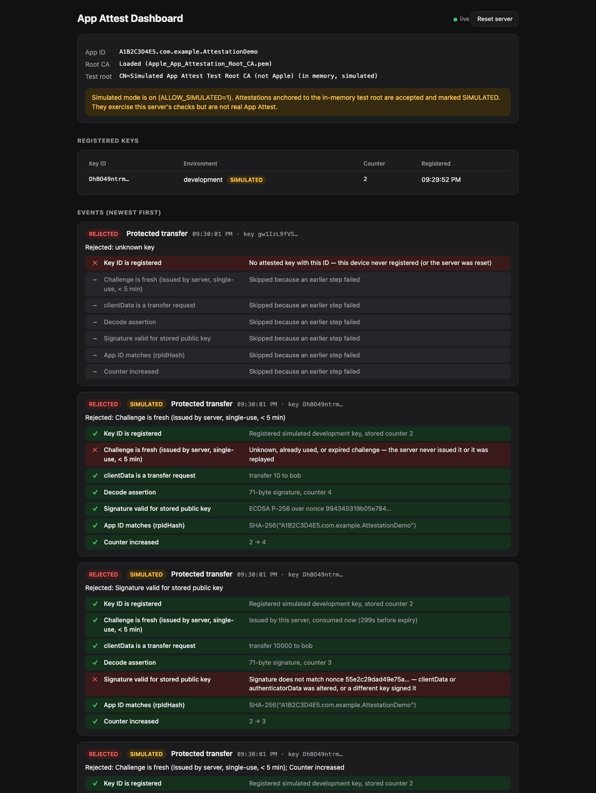
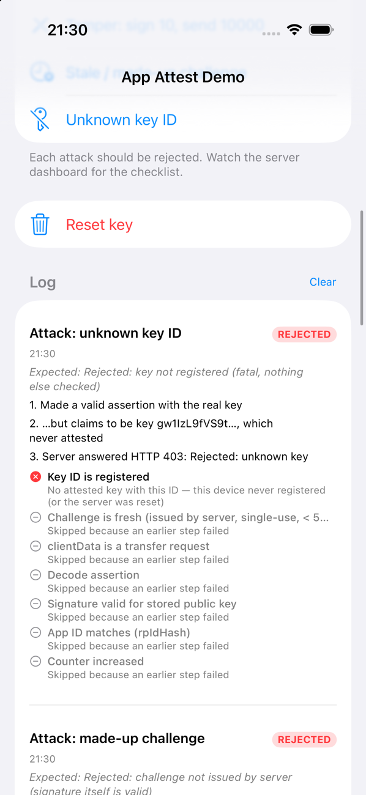
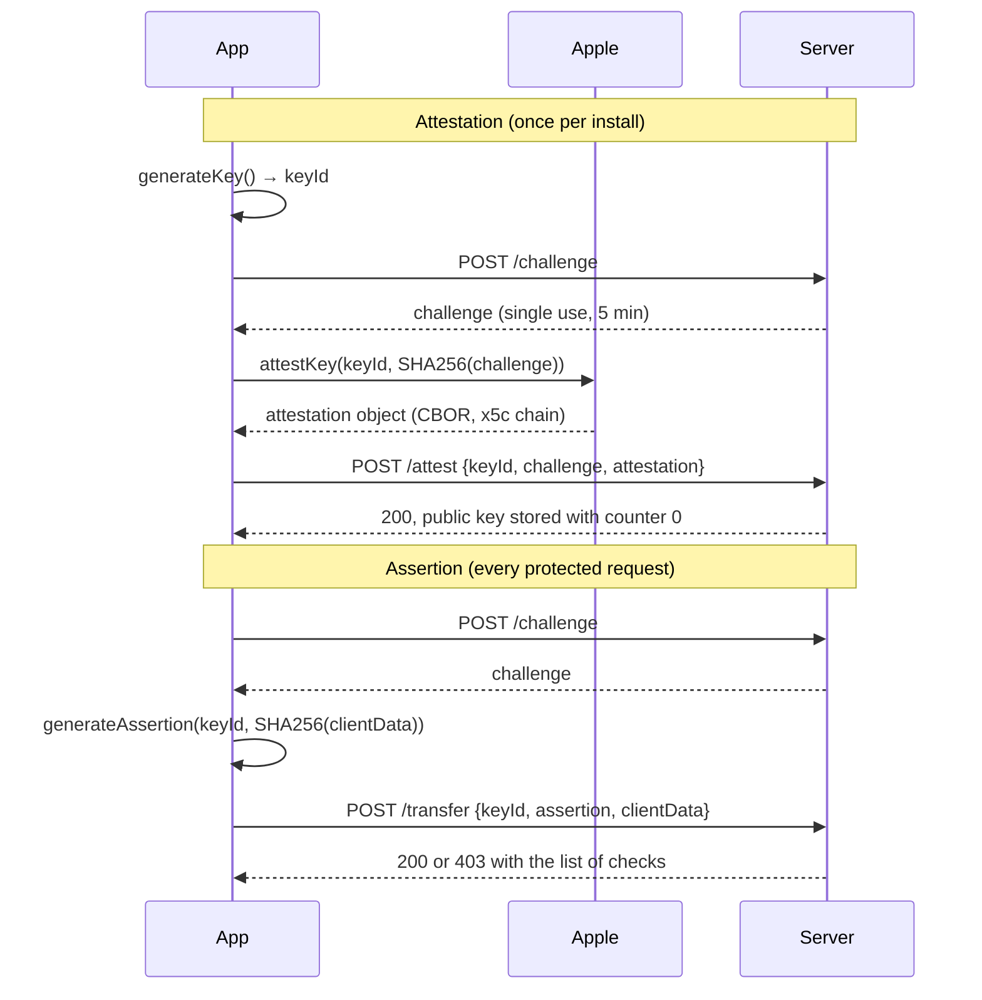

# iOS App Attest Demo

A working example of Apple's [App Attest](https://developer.apple.com/documentation/devicecheck/establishing-your-app-s-integrity) (`DCAppAttestService`): a SwiftUI app that attests itself, and a Swift (Vapor) server that verifies every attestation and assertion and shows each check on a live dashboard. The app also sends four forged requests so you can watch the server reject them.

<p>
  
  
</p>

*Screenshots were taken in the Simulator fallback mode, hence the SIMULATED badges.*

## What App Attest proves

App Attest lets a server confirm that a request comes from a genuine copy of your app running on a genuine Apple device.

- The device generates a P-256 key pair in the Secure Enclave. The private key cannot be exported.
- Apple signs a certificate for that key. The certificate is bound to your App ID (`TEAMID.bundleID`) and to a challenge from your server.
- The app then signs requests with the key. Each signature covers the request body and a counter that only goes up.

It does not encrypt anything and does not identify the user. Apple recommends treating it as one signal in a wider risk assessment.

## Flow



`clientData` is the exact JSON the app signs: `{"challenge":…,"action":"transfer","amount":10,"to":"bob"}`.

## What the server verifies

Attestation, `POST /attest`:

| Check | Rule |
|---|---|
| Challenge is fresh | Issued by this server, unused, under 5 minutes old |
| Decode | CBOR with `fmt = apple-appattest`, `attStmt.x5c`, `authData` |
| Certificate chain | `x5c` validates to the Apple App Attestation Root CA |
| Nonce | `SHA256(authData ‖ SHA256(challenge))` equals leaf extension `1.2.840.113635.100.8.2` |
| Key ID | `keyId == SHA256(leaf public key)` |
| App ID | `authData.rpIdHash == SHA256("TEAMID.bundleID")` |
| Counter | `0` |
| AAGUID | `appattestdevelop` or `appattest` + 7 zero bytes |
| Credential ID | Equals `keyId` |

Assertion, `POST /transfer`:

| Check | Rule |
|---|---|
| Key ID is registered | A public key was stored for this `keyId` |
| Challenge is fresh | The challenge inside `clientData` is unused and unexpired |
| Decode | CBOR with `signature` and `authenticatorData` |
| Signature | ECDSA P-256 over `SHA256(authenticatorData ‖ SHA256(clientData))` with the stored key |
| App ID | `rpIdHash == SHA256("TEAMID.bundleID")` |
| Counter | Greater than the stored counter |

The key and counter are stored or updated only when every check passes.

## Attack scenarios

| Button in the app | What it sends | Failed check |
|---|---|---|
| Replay last request | The previous request, byte for byte | Challenge is fresh, Counter |
| Tamper | Signs amount 10, sends amount 10000 | Signature |
| Stale / made-up challenge | A valid signature over a challenge the server never issued | Challenge is fresh |
| Unknown key ID | A valid assertion under a random `keyId` | Key ID is registered |

## Run it

Requirements: a physical iPhone (iOS 17+), a paid Apple Developer team, Xcode 16+, and the Mac and iPhone on the same network.

1. Download Apple's root certificate:

   ```sh
   curl -o Server/Apple_App_Attestation_Root_CA.pem https://www.apple.com/certificateauthority/Apple_App_Attestation_Root_CA.pem
   ```

2. Set your team and bundle ID:

   ```sh
   cp App/Local.xcconfig.example App/Local.xcconfig
   ```

   Edit `App/Local.xcconfig`. It is gitignored.

3. Start the server with the matching App ID:

   ```sh
   APP_ID=<TEAMID>.<bundle id> swift run --package-path Server Server
   ```

   The dashboard is at `http://localhost:8080/`. The server prints the LAN URL for the phone.

4. Run `App/AttestationDemo.xcodeproj` on the iPhone, enter the LAN URL, and tap **Register device**.

The Mac's firewall must allow incoming connections to the server binary.

### Simulator fallback

App Attest does not exist in the Simulator. To try the flow without a device, start the server with `ALLOW_SIMULATED=1` and run the app in any iOS Simulator:

```sh
ALLOW_SIMULATED=1 APP_ID=<TEAMID>.<bundle id> swift run --package-path Server Server
```

The Simulator build uses a software P-256 key, and the server issues its certificate from an in-memory test CA through `POST /simulator/attest-key`. The same checks run, and everything anchored to the test CA is labelled SIMULATED. This is not real attestation: nothing is vouched for by Apple. Without the flag the endpoint returns 404 and test-CA chains are rejected.

## Configuration

| Variable | Default | Purpose |
|---|---|---|
| `APP_ID` | placeholder | `TEAMID.bundleID` the server expects |
| `PORT` | `8080` | Listen port |
| `APPLE_ROOT_CA_PATH` | `Server/Apple_App_Attestation_Root_CA.pem` | Trust anchor |
| `ALLOW_SIMULATED` | off | Accept the in-memory test CA |

## API

Binary fields are base64 in JSON.

| Endpoint | Body | Response |
|---|---|---|
| `POST /challenge` | – | `{challenge}` |
| `POST /attest` | `{keyId, challenge, attestation}` | 200 or 403 `{ok, message, checks}` |
| `POST /transfer` | `{keyId, assertion, clientData}` | 200 or 403 `{ok, message, checks}` |
| `GET /state` | – | Config, registered keys, events |
| `POST /reset` | – | Clears all state |
| `POST /simulator/attest-key` | `{publicKey, nonce}` | `{x5c}`, simulated mode only |

## Project layout

```
App/                              SwiftUI app (iOS 17+)
Server/Sources/AppAttestVerifier  CBOR decoder, authenticator data parser, both verifiers
Server/Sources/Server             Vapor routes, in-memory store, dashboard
```

The verifier has no CBOR dependency. Certificate validation uses [swift-certificates](https://github.com/apple/swift-certificates), signatures use [swift-crypto](https://github.com/apple/swift-crypto).

## Limitations

- State is in memory. Restarting the server forgets all keys; tap **Reset key** in the app and register again.
- The attestation receipt is not sent to Apple for the fraud risk metric.
- The entitlement is set to the `development` environment. Use `production` for TestFlight and App Store builds.
- Plain HTTP on the local network. Use TLS for anything real.

## References

- [Establishing your app's integrity](https://developer.apple.com/documentation/devicecheck/establishing-your-app-s-integrity)
- [Validating apps that connect to your server](https://developer.apple.com/documentation/devicecheck/validating-apps-that-connect-to-your-server)
- [`DCAppAttestService`](https://developer.apple.com/documentation/devicecheck/dcappattestservice)
